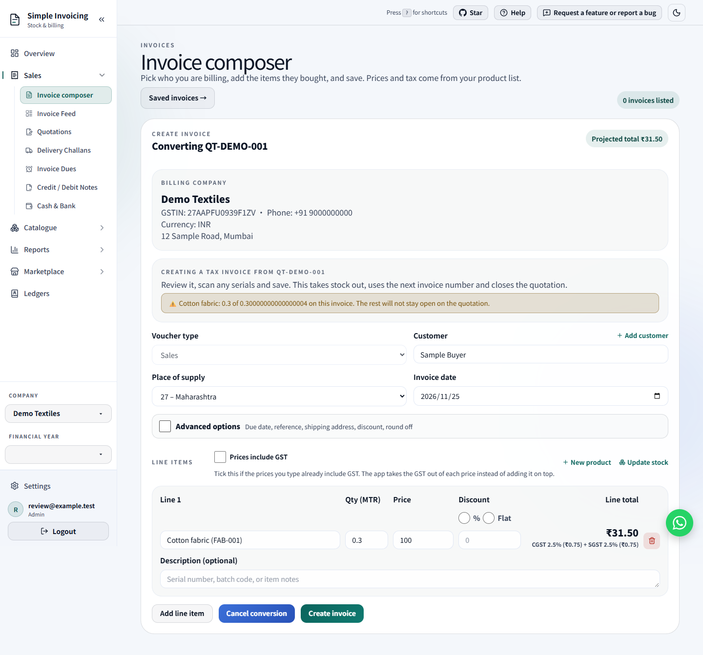
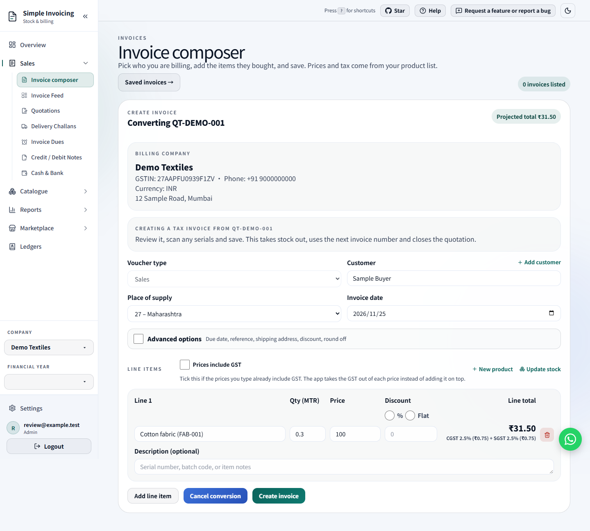

# Quotation quantity comparison: browser evidence

These are real Chromium captures of the Simple Invoicing frontend with a localhost fixture API. All company, buyer, product and quotation data shown are synthetic. No invoice was saved.

Both captures open quotation QT-DEMO-001 with two cotton-fabric lines of 0.1 and 0.2 metres. Through the actual composer controls, the first line is changed to 0.3 and the second is removed.

| Before | After |
| --- | --- |
|  |  |

The before capture serves the already-built application with only `conversionLineShortfalls` replaced in memory by that function compiled from baseline commit `720300a7b3c11fab575ccf585582f054448a6363`. It displays the false warning "0.3 of 0.30000000000000004". The after capture serves the untouched tested build and has no reduction warning.

Both runs use the same explicit fixture API responses and user actions. Browser execution reported no page errors or unmocked API endpoints. Source and build files were read only; hashes were checked after capture. This evidence branch contains only the two images and this provenance document; it does not change the code PR branch.

Browser: `156.0.8078.4`. Build bundle SHA-256: `d4dcd5a003ab7b2e0bd25c436dfda0fb06080bf70978bf539b29205ac52ef42d`.

Tested source hashes:

- `frontend/src/utils/quotationDraft.ts`: `988364f4bb33987eb70611a9e35fb0d61f28ccb2c2397e733b68abde256c3ae1`
- `frontend/src/utils/quotationDraft.test.ts`: `c6d171ffb5357a8a6ce3e56fe96fd927b1a4a563466f019cb39b2550b5cb9e3e`

Prepared and validated with assistance from OpenAI Codex.
